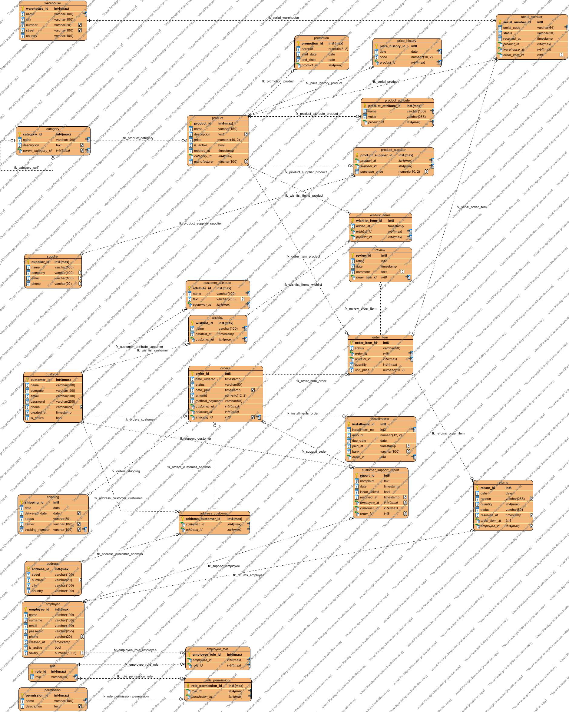

# Фаза 1 — ЕР дијаграм

**Статус:** во тек, не е одобрен.
**Алатка:** Visual Paradigm (desktop).
**Дијаграм:** [`diagrams/er-diagram.vpp`](diagrams/er-diagram.vpp) (Visual Paradigm) · **Слика:** [`diagrams/er-diagram-picture.jpg`](diagrams/er-diagram-picture.jpg). Првата верзија е во `reference/er_diagram_picture.png`.

## 1. Преглед на моделот

Моделот има **27 ентитети**, групирани во 6 модули. Сите врски M:N се разрешени со посебни поврзувачки табели.

| Модул | Ентитети |
| --- | --- |
| Администрација | role, permission, role_permission, employee, employee_role |
| Купувачи | customer, customer_attribute, address, address_customer, wishlist, wishlist_items |
| Каталог | category, product, product_attribute, supplier, product_supplier, price_history, promotion |
| Магацин | warehouse, serial_number |
| Нарачки | orders, order_item, shipping, installments |
| Постпродажба | review, returns, customer_support_report |

## 2. Врски и кардиналности

„Задолжителна“ значи дека FK колоната е NOT NULL, односно во ЕР е „точно еден“ на страната на родителот.

| Дете (FK) | Родител | Кардиналност | Задолжителна | ON DELETE |
| --- | --- | --- | --- | --- |
| role_permission.role_id | role | N : 1 | да | CASCADE |
| role_permission.permission_id | permission | N : 1 | да | CASCADE |
| employee_role.employee_id | employee | N : 1 | да | CASCADE |
| employee_role.role_id | role | N : 1 | да | CASCADE |
| customer_attribute.customer_id | customer | N : 1 | да | CASCADE |
| address_customer.customer_id | customer | N : 1 | да | CASCADE |
| address_customer.address_id | address | N : 1 | да | CASCADE |
| wishlist.customer_id | customer | N : 1 | да | CASCADE |
| wishlist_items.wishlist_id | wishlist | N : 1 | да | CASCADE |
| wishlist_items.product_id | product | N : 1 | да | CASCADE |
| category.parent_category_id | category (рекурзивна) | N : 1 | не | SET NULL |
| product.category_id | category | N : 1 | да | RESTRICT |
| product_attribute.product_id | product | N : 1 | да | CASCADE |
| product_supplier.product_id | product | N : 1 | да | CASCADE |
| product_supplier.supplier_id | supplier | N : 1 | да | CASCADE |
| price_history.product_id | product | N : 1 | да | CASCADE |
| promotion.product_id | product | N : 1 | да | CASCADE |
| serial_number.product_id | product | N : 1 | да | CASCADE |
| serial_number.warehouse_id | warehouse | N : 1 | да | RESTRICT |
| serial_number.order_item_id | order_item | N : 1 | не | SET NULL |
| orders.customer_id | customer | N : 1 | да | RESTRICT |
| orders.(customer_id, address_id) | address_customer | N : 1 | да | RESTRICT |
| orders.shipping_id | shipping | 1 : 1 (UNIQUE) | не | SET NULL |
| order_item.order_id | orders | N : 1 | да | CASCADE |
| order_item.product_id | product | N : 1 | да | RESTRICT |
| installments.order_id | orders | N : 1 | да | CASCADE |
| review.order_item_id | order_item | 1 : 1 (UNIQUE) | да | CASCADE |
| returns.order_item_id | order_item | N : 1 | да | CASCADE |
| returns.employee_id | employee | N : 1 | не | SET NULL |
| customer_support_report.customer_id | customer | N : 1 | да | CASCADE |
| customer_support_report.employee_id | employee | N : 1 | не | SET NULL |
| customer_support_report.order_id | orders | N : 1 | не | SET NULL |

## 3. Клучни одлуки во моделирањето

- **Сериски броеви наместо количина на залиха.** Секој уред е посебен ред во `serial_number`. Така се следат гаранција, враќања и точно кој уред е продаден (`order_item_id`). Залихата е бројот на редови со `status = 'in_stock'`. **Одлука на тимот:** секој артикл во продавницата има сериски број, вклучително и ситните (кабли, полначи, глувчиња). Каде што нема фабрички, продавницата доделува интерен код (налепница со баркод) при прием. Затоа нема посебна табела за залиха по количина.
- **Цена во моментот на купување.** `order_item.unit_price` ја чува цената при нарачката. Затоа промена на `product.price` не ги менува старите нарачки. Историјата на цени е во `price_history`.
- **Адреса на нарачка.** Нарачката покажува на адреса преку композитен клуч `(customer_id, address_id)` кон `address_customer`. Така базата гарантира дека адресата му припаѓа на купувачот.
- **Историјата не се брише.** Купувач, производ, категорија и магацин што се користат во нарачки не можат да се избришат (RESTRICT). Се деактивираат со `is_active`.
- **Улоги и дозволи (RBAC).** Тоа се две M:N врски: вработен–улога и улога–дозвола.

## 4. Промени во однос на првата верзија на ЕР

| Ентитет | Промена | Причина |
| --- | --- | --- |
| employee | отстранета `returnsreturn_id` | погрешен FK; врската ја чува `returns.employee_id` |
| warehouse | отстранета `warehousewarehouse_id`, додадено `name` | рекурзијата немаше значење |
| permissions → permission | отстранети `role_id`, `is_allowed_to_access`; додадено `name` (уникатно) | дуплирање со `role_permission` |
| order → orders | нова `address_id`; `date_payed` → `date_paid` | адреса за достава; `order` е резервиран збор |
| order_item | отстранета `date`; додадена `unit_price` | датумот е во нарачката; цена при купување |
| serial_number | додадени `serial_code`, `status`, `received_at`, `order_item_id` | немаше колона за самиот сериски број |
| installments | `loan_id` → `installment_id`; додадени `installment_no`, `due_date`, `paid_at` | следење на рати |
| returns | отстранета `is_approved`; додадени `quantity`, `resolved_at` | дуплирање со `status` |
| wishlist | `user_id` → `customer_id`; додадени `name`, `created_at` | конзистентност |
| shipping | додадена `delivered_date` | проверка на доставата |
| customer_support_report | додадени `order_id`, `resolved_at` | врска со нарачка, време на решавање |
| Сите | `is_active`, `issue_solved` → boolean | тип |

## 5. Белешки од консултации

| Датум | Со кого | Забелешка | Што сменивме |
| --- | --- | --- | --- |
| | асистент | | |
| | професор | | |

## 6. Усогласеност со DDL

ЕР дијаграмот е спореден програмски со шемата од `00_ddl/ddl_v2.sql`. Споредбата е направена директно од `.vpp` фајлот и од каталогот на PostgreSQL, на 2026-10-20.

| Проверка | ЕР | DDL | Резултат |
| --- | --- | --- | --- |
| Табели | 27 | 27 | исти |
| Колони (име, тип, должина, NULL) | 144 | 144 | 0 разлики |
| Надворешни клучеви | 32 | 32 | исти, со исти имиња |
| UNIQUE ограничувања | 19 | 19 | исти |

Не се прикажани во ЕР, туку се само во DDL:

- **CHECK ограничувањата и DEFAULT вредностите.** Тие не се дел од ЕР нотацијата.
- **Уникатниот индекс на `lower(email)`** кај `customer`, `employee` и `supplier`. Visual Paradigm не моделира индекс врз израз.
